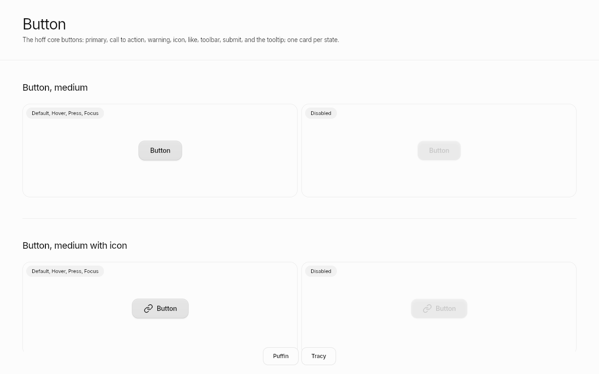
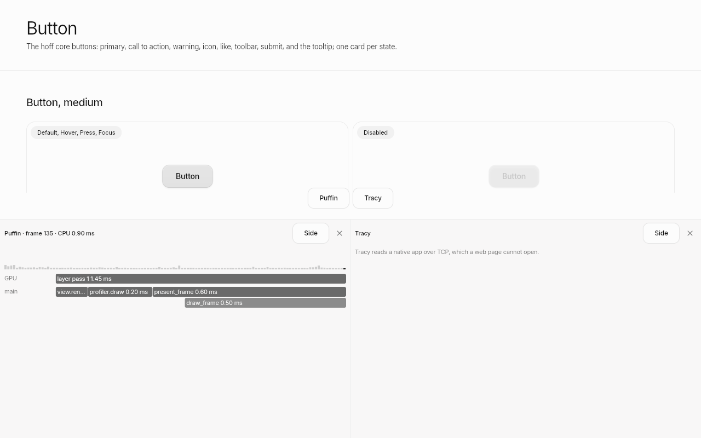
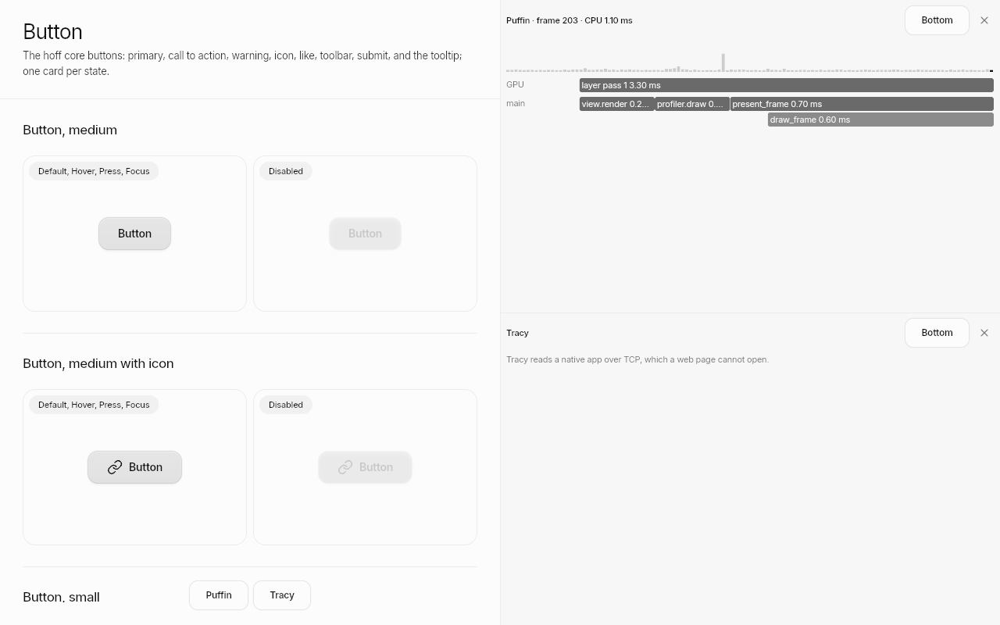

# task-105: the frame in Puffin and Tracy, from a panel over any gallery tab

A proof of concept that tries two ways of profiling the engine from inside the gallery. Two small buttons, **Puffin** and **Tracy**, sit at the bottom center of any tab. Each opens its part of a panel docked in the window: below the page or beside it ("Side" and "Bottom" move it), half of the window, the two parts side by side when both are open. The page lays out again in the other half, so nothing of it hides under the panel. Everything lives behind the `profiler` and `tracy` features of the gallery and the engine, off by default; without them the gallery, its tests and its baselines do not change.

## The two parts

- **Puffin** draws the frames recorded since it opened (`apps/uigallery/src/shell/window/profiler/flame.rs`). Bars show the CPU time of the last 120 frames. Below them, the latest frame appears thread by thread, each scope a bar as long as it took, the scopes it holds under it. The CPU comes from `engine::cpu_scope!` (`view.render`, `profiler.draw`, `present_frame`, `draw_frame`). The GPU comes from wgpu-profiler's timing of each pass of `draw_frame` (`layer pass N`, `composite pass`), reported on a thread named "GPU" that runs on the GPU's own clock.
- **Tracy** works the way Tracy is meant to (`tracy.rs`). The gallery starts its client before the first frame, and the client collects only while the Tracy GUI is connected. The part says whether the GUI is connected, and its "Open Tracy" button starts the GUI (`PLEV_TRACY`, else `tracy-profiler` on the PATH; v0.14.0). The analysis happens in Tracy's own window. On the web the part says why Tracy is absent: Tracy speaks TCP, which a page cannot open.

## Choices made on the way

- **No `profiling` crate.** It takes a single backend, and this POC uses two. `engine::cpu_scope!` writes a Puffin scope and, with `profiler-tracy`, a Tracy zone. wgpu's internal scopes are left out.
- **The frame ends after the present** (`WindowHost::present`). A Puffin frame holds what the gallery built for it and not the wait for the next one. Ended inside `draw_frame`, a frame ran from one present to the next `view.render`, and its CPU time was mostly idle.
- **The CPU time leaves the GPU's thread aside.** Puffin's own range of a frame mixes the GPU's clock into the CPU's, which made frames of seconds.
- **The GPU is timed per pass.** Apple's GPUs and WebGPU write timestamps only where a pass begins and ends. wgpu-profiler enters through each pass's `timestamp_writes` (`PassStamps`, beside the engine's `FrameStamps`). With the feature on, the device asks for `TIMESTAMP_QUERY`, and `TIMESTAMP_QUERY_INSIDE_ENCODERS` where the adapter has it, which Tracy's GPU context needs for its clock sync.
- **Versions.** wgpu-profiler 0.27 is the last on wgpu 29. It fixes puffin 0.19 and tracy-client 0.18, and `tracy-client-sys` is pinned at 0.29, the protocol of Tracy v0.14.0.
- **A first try was dropped.** A Profiler page started the puffin_viewer and Tracy as programs of their own. That was not what was asked: the tools open inside the window, from any tab.

## Seen working

The web build (`trunk build --features profiler`) ran in Chromium with WebGPU on the HF's GTX 1060. Below are the buttons over the Button tab, both parts open below the page, and the panel moved to the side. In the second image a frame is 0.90 ms of CPU (`view.render`, `profiler.draw` 0.20 ms, `present_frame` 0.60 ms holding `draw_frame` 0.50 ms), and the GPU's layer pass is on its own line.

The macOS run, with Tracy connected, is still to be seen.

<!-- related: written by tool/tasks/docbase.py index from the relations in the headers; edit the headers, not this list -->
## Related

- [ADR 0008: render on demand makes invalidation a correctness contract](../../adr/Rendering/0008-render-on-demand-requires-explicit-invalidation/0008-render-on-demand-requires-explicit-invalidation.md)
<!-- /related -->
