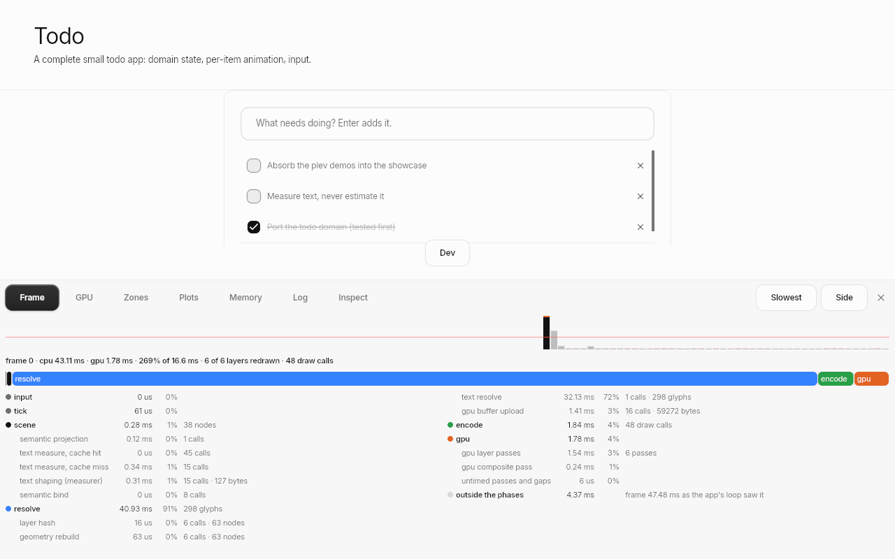
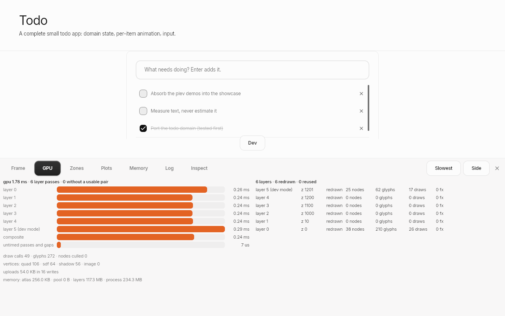
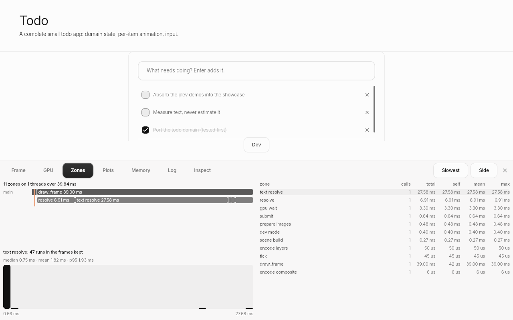
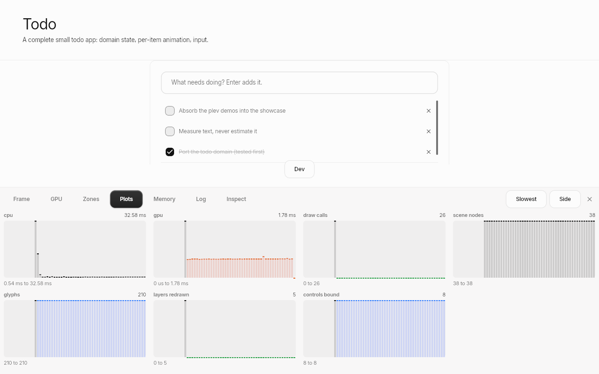
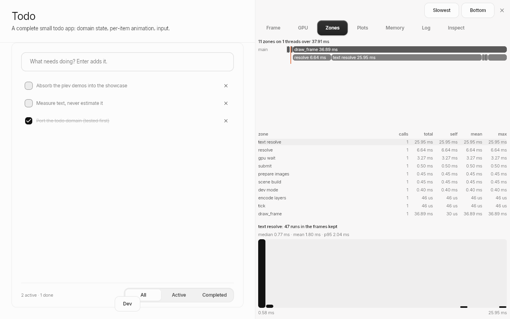

# task-105: a dev mode over any app: the frame, the GPU, the zones, the heap and the page's controls

The engine's own view of what it does, drawn over any app. A small **Dev** button sits at the bottom center of the page. It opens a panel docked in the window, below the page or beside it ("Side" and "Bottom" move it), half of the window. The page lays out again in the other half, so nothing of it hides under the panel. A launch gets its dev mode with `PLEV_DEV=1`. Without it nothing is drawn, no event is taken and nothing is measured.

No dependency was added. The clocks, the counters and the panel are the engine's own, and the panel is drawn with the engine's widgets and the theme's tokens.

The task began as a proof of concept that put Puffin and Tracy behind two features of the gallery. That first try was refused and is gone from the tree; what it taught is at the end.

## The seven views

- **Frame** is the whole frame at a high level. The last 120 frames are bars (the CPU under the GPU, a line where the 16.6 ms budget is passed). The frame shown is one bar cut into the six phases a frame runs (input, tick, scene, resolve, encode, gpu), and under it each phase lists the stages that ran inside it with their time, their share and what they counted. A press on a bar of the history shows that frame.
- **GPU** has one bar per render pass of the frame, each with the layer it drew and its own time from the GPU's timestamps, then the composite pass and what the passes do not cover. Beside it are the layers (z order, redrawn or reused, nodes, glyphs, draw calls, effects), the frame's counters and the memory.
- **Zones** puts the CPU's named zones on one time axis, thread by thread, each zone a bar with the zones it holds under it. The lines code said in the frame cross it as marks. The table gives every zone's calls, total, own time, mean and longest run. A press on a row chooses a zone, and its runs over the frames kept are counted in a histogram with the median, the mean and the 95th percentile.
- **Plots** charts what each frame counted over the frames kept: the CPU's time, the GPU's, and the page's draw calls, scene nodes, glyphs and layers redrawn. Every value the app's code gave under a name follows them.
- **Memory** counts the heap block by block: blocks and bytes asked for and given back in the frame, what the frame kept, and three charts over the frames. Beside it is what the engine holds on the GPU (glyph atlas, texture pool, layers) and the process's resident memory.
- **Log** lists the lines code said, with the frame, the moment and the thread of each.
- **Inspect** shows one control of the page. "Pick a control" arms the pointer: the control under it is ringed and a press chooses it instead of reaching the page. The view gives its id, role, label, state, actions and flags (the app's semantic snapshot), the code that projected it, where it sits, and what its layer did in the frame shown.

"Latest" and "Slowest" choose which frame every view shows.

## What an app writes

```rust
engine::zone!("scene build");                  // a named zone, to the end of the block
engine::plot!("controls bound", count);        // a value under a name, one per frame
engine::message!("page {name} staged");        // a line of text at this moment

#[global_allocator]                            // the heap, counted
static HEAP: engine::runtime::perf::heap::Counting =
    engine::runtime::perf::heap::Counting::system();
```

Off, each of the three macros is one relaxed atomic load and a branch: no clock is read, no lock is taken and the message's text is never built. The counted allocator adds one relaxed load to a call until the dev mode turns its counters on. An app that does not install it reads no heap in the Memory view, and the view says so.

## Where it lives

- **The data** is in `rust/engine/src/runtime/perf/`: `zones` (nested zones per thread on one clock), `marks` (plots and messages), `heap` (the counting allocator), `histogram`, `pipeline` (the 22 stages grouped into six phases), `gpu_time` (each pass with its layer and its frame) and `report` (`FrameReport`, one frame complete, and `Recorder`, the last 240 of them).
- **The panel** is in `rust/engine/src/runtime/dev/` (`DevMode`), one file per view and `paint.rs` for what they draw with. It measures nothing itself.
- **The mount** is the gallery's shell: the pointer goes to the dev mode first, the page is resized to its share, and the panel is drawn after the page. A window host owns its recorder (`WindowHost::dev`).
- **Without a window**, `uigallery --render <page> --dev <view> [--dev-side] --out file.png` draws 48 frames with the panel open and writes the last one. Every image below was made this way.

## Choices made on the way

- **A report is exactly one frame.** The stages, zones and marks are taken after the present, so a frame holds what the app built for it and not the wait for the next one.
- **The GPU's time is attached after the fact.** Timestamps are read back by a later frame, and each reading carries the index of the frame it measured. The engine renders on demand, so after the last frame of a change the panel asks for up to three frames of its own to bring the timestamps back. Those frames are flagged and left out of "Latest", "Slowest" and every chart.
- **The page's counts leave the dev mode out.** The panel is a layer of the same frame. The GPU view names it "(dev mode)", and the Plots view leaves it out of the page's draw calls, nodes, glyphs and layers: a panel that draws more as its history grows was the curve itself.
- **The heap is counted from the moment the dev mode exists, not from the start of the process.** A block older than that is counted when it is given back and never when it was asked for, so "live bytes" is the heap's change since then and can go below zero.
- **Headless contexts give the GPU's objects no debug names off Apple's platforms** (`GpuContext::instance_flags`). The engine's GPU tests crashed in about one parallel run in four on the Linux machine (6 of 24). In the Vulkan loader Ubuntu 26.04 ships (1.4.341, fixed upstream after it, KhronosGroup/Vulkan-Loader#1863), naming an object walks every driver and device of the process while another thread's new instance unloads the drivers that found no device. With only the NVIDIA driver loaded the crash stopped (0 of 30), which confirmed it. With no names: 0 crashes in 90 parallel runs. A window keeps its names: it is made and dropped on the thread that draws.
- **GPU timestamps are asked for only with the dev mode** (`RenderConfig::gpu_timestamps`). A launch without it opens the same device as before.

## Seen working

Rendered without a window on a GTX 1060 (Vulkan), debug build, the Todo page at 1280 by 800. Every number is the engine's own measure of that run.

The first frame takes 43.11 ms of CPU and 1.78 ms of GPU. Resolve is 91% of the CPU, and text resolve alone 72%: the first frame shapes and rasterizes every glyph.



Six layers are redrawn in the first frame. Four of them hold no node and still cost a pass of 0.24 ms each.





After the first frame the page redraws no layer and makes no draw call: render on demand, seen from inside.



The first frame asks the heap for 9,162 blocks (3.0 MB) and gives 7,712 back. The layers hold 117.3 MB of the 117.5 MB the engine keeps on the GPU.




## Not done

- The panel was not seen on a screen. The gallery's shell is tested through its own pointer and frame paths against a window that draws into a texture (`shell/window/pace/tests.rs`): a press on **Dev** opens the panel, the page takes half of the window, six frames are recorded with their zones, the page's plot and the GPU's time, the pixel in the window's corner changes, and a second press gives the page the window back. No one has opened it with `PLEV_DEV=1` and a real pointer yet.
- On the web there is no way to turn it on: the page has no environment to read `PLEV_DEV` from.
- There is no key to open the panel, and the gallery's loop does not record the input stage.
- Of what Puffin and Tracy offer, these were not built: sampling with call stacks, the source view of a zone, context switches and lock contention, frame images, saving and loading a capture, comparing two captures, and the heap per zone.
- On the Linux machine, about one parallel run in thirty of the engine's GPU tests hangs. A core dump shows a deadlock inside the NVIDIA driver (580.178.04): a thread in `vkDestroyDevice` holds a driver mutex while it waits for one of the driver's threads to end, and a test thread that is ending waits for that mutex. It happened before this task too. Keeping devices alive avoided it, but each device holds about 130 MiB of a GPU shared with other programs and the larger groups ran out of memory. With one test at a time the whole suite passes.

## What the first try taught

The first try drew Puffin's frames in a panel and left Tracy's analysis to Tracy's own window, with wgpu-profiler timing the GPU. Reading it before replacing it found:

- the stages were taken before the present, so a frame's boundary was wrong;
- the GPU's stages never reached the panel, and the app's own stages (frame, input, tick, scene build) were not recorded in the gallery;
- a pass had no layer, so its time could not be traced to what was drawn;
- the panel measured itself: it woke the window four times a second;
- six tools read the frame and no two of them shared a report.

Each of those is answered by one frame report that every view reads.

<!-- related: written by tool/tasks/docbase.py index from the relations in the headers; edit the headers, not this list -->
## Related

- [ADR 0008: render on demand makes invalidation a correctness contract](../../adr/Rendering/0008-render-on-demand-requires-explicit-invalidation/0008-render-on-demand-requires-explicit-invalidation.md)
<!-- /related -->
