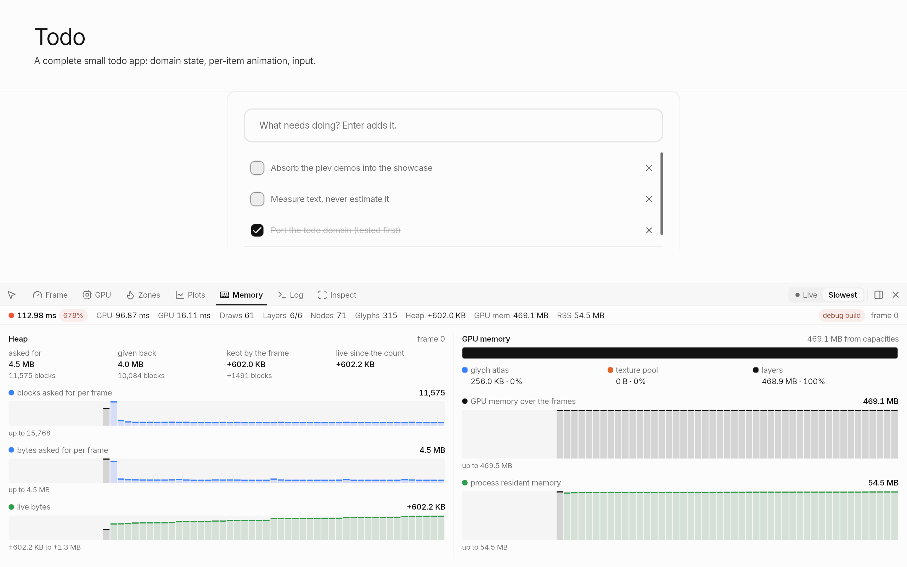
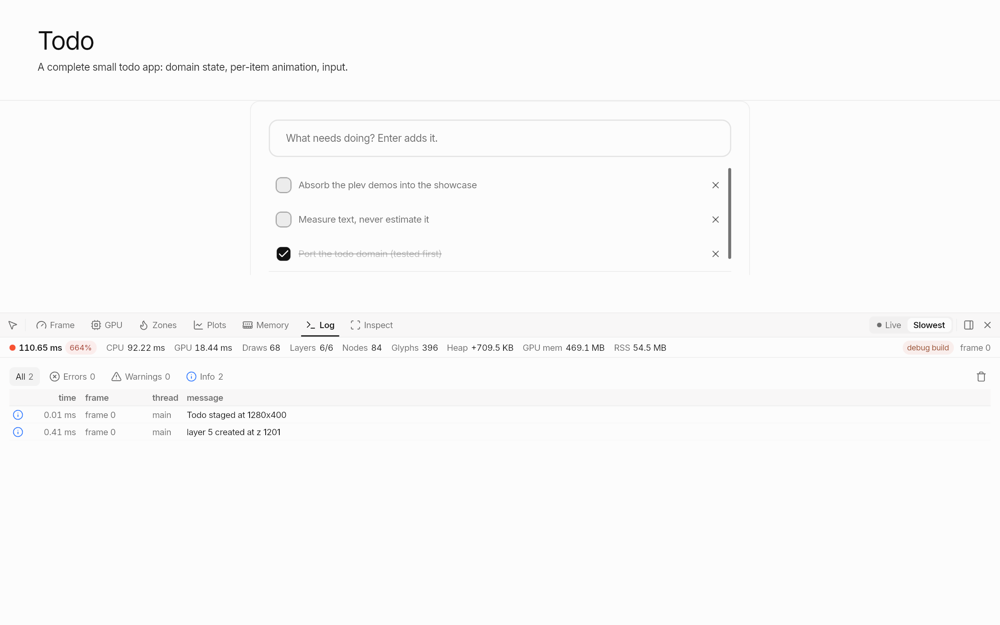
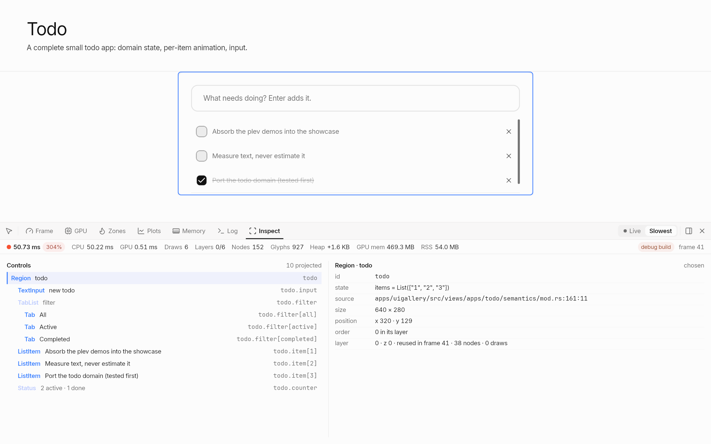

# task-105: a dev mode over any app: the frame, the GPU, the zones, the heap and the page's controls

The engine's own view of what it does, drawn over any app. A small gear sits at the page's lower right corner. It opens a panel docked in the window, below the page or beside it, and the page lays out again in what is left, so nothing of it hides under the panel. The panel's edge drags to give it more or less of the window.

A launch gets its dev mode from `PLEV_DEV`: `1` for the gear, a view's name (`PLEV_DEV=gpu`) for the panel already open on that view. F12 opens and closes the panel. Without the variable nothing is drawn, no event is taken and nothing is measured.

```sh
PLEV_DEV=1 cargo run -p uigallery
```

No dependency was added. The clocks, the counters and the panel are the engine's own, and the panel is drawn with the theme's tokens and the engine's icons.

The task began as a proof of concept that put Puffin and Tracy behind two features of the gallery. That first try was refused and is gone from the tree; what it taught is at the end. The panel that replaced it measured well and read badly: a large "Dev" button in the middle of the page, tabs as big as buttons, a GPU view that showed no time in a window, a log that was empty a few seconds after anything was said. The third pass, of 2026-11-25, is the one described here.

## The panel

The head is one strip of small tabs, each an icon and a name, the one shown underlined. Before them is the picker (the pointer chooses a control on the page). After them is which frame every view shows: **Live** (the latest frame, once it is whole), **Slowest**, or the frame chosen in the history, which shows as a third choice with its number. Then the dock to move the panel to, and the close. A panel too narrow for every name keeps the icons and names the tab shown; narrower still, the choices go under the tabs.

Under the strip one line stays whatever the tab: the frame's time with its share of the 16.6 ms budget (green inside it, amber past three fifths, red over), the CPU's and the GPU's time, draw calls, layers redrawn, nodes, glyphs, what the frame did to the heap, the GPU memory and the process's resident memory. A debug build says so there, since its times are several times a release build's.

## The seven views

- **Frame** is where the frame's time went, and what that means. The last 120 frames are bars (the CPU under the GPU) against the budget line; a press on a bar shows that frame. The frame shown is one bar cut into the six phases a frame runs (input, tick, scene, resolve, encode, gpu), and under it each phase lists the stages that ran inside it with their time, their share and what they counted. Beside them are the **insights**: the findings read from the frame, a line each with the numbers behind it. A press on one opens the view that holds them.
- **GPU** has one bar per render pass of the frame, each with the layer it drew and its own time from the GPU's timestamps, then the composite pass and what the passes do not cover, and the frame's counters. Beside it are the layers as a table (z order, redrawn or reused, nodes, glyphs, draw calls, effects, GPU time).
- **Zones** puts the CPU's named zones on one time axis, thread by thread, each zone a bar with the zones it holds under it, in a color that is the zone's wherever it shows. The lines code said in the frame cross it as marks. The table gives every zone's calls, total, own time and its share, mean and longest run. A press on a row or on a bar chooses a zone, and its runs over the frames kept are counted in a histogram with the median, the mean and the 95th percentile.
- **Plots** charts what each frame counted over the frames kept: the CPU's time, the GPU's, and the page's draw calls, scene nodes, glyphs and layers redrawn. Every value the app's code gave under a name follows them.
- **Memory** counts the heap block by block: bytes and blocks asked for and given back in the frame, what the frame kept, and three charts over the frames. Beside it is what the engine holds on the GPU as one bar cut by what holds it (glyph atlas, texture pool, layers), and the process's resident memory.
- **Log** lists the lines code said (`engine::message!`) and the process logged (`log::warn!`, `log::error!` and the rest the console shows), each with its level, its moment, its frame and its thread. A warning and an error stand on a tinted line. The counts a level filter to it, the bin hides what was said so far, and the wheel scrolls back. The lines outlive their frames: the last 500 are kept, and what was said before the panel opened is there.
- **Inspect** shows the page's controls as a tree (the app's semantic snapshot: a role and a label a line, under its parent) and, beside it, the control chosen: its id, state, actions and flags, the code that projected it, its size and place, and what its layer did in the frame shown. A press on a line chooses a control, and the pointer over a line rings it on the page with its role and size. The picker does it the other way: the control under the pointer on the page is ringed, and a press chooses it instead of reaching the page. A page that projects nothing lists the ids its frame bound.

## The insights

Each is a rule over the frame shown and the frames kept, with the numbers it was drawn from in its words. None is a guess about code the engine cannot see.

- the frame against the 16.6 ms budget, with the phase and the step that took most of it (this one opens the list);
- errors and warnings in the log, with the last one said;
- layers redrawn that hold no node: a render pass each, for no pixel;
- the text measurer's cache missing a quarter of its questions or more;
- a frame that asks the heap for a thousand blocks or more, and a heap that grew a megabyte over the frames kept (read once the recorder's history is full, since the reports it keeps are heap too);
- zones, plots or messages over a frame's limits, not kept;
- what bounds the reading: a debug build, a device without GPU timestamps, a heap that is not counted, passes that wrote no end, the dev mode's own time in the frame;
- and what is as it should be: nothing redrawn, the frame inside the budget.

## What an app writes

```rust
engine::zone!("scene build");                  // a named zone, to the end of the block
engine::plot!("controls bound", count);        // a value under a name, one per frame
engine::message!("page {name} staged");        // a line of text at this moment

#[global_allocator]                            // the heap, counted
static HEAP: engine::runtime::perf::heap::Counting =
    engine::runtime::perf::heap::Counting::system();

// what the console shows, in the Log view too
log::set_boxed_logger(Box::new(engine::runtime::perf::Tee::new(logger)));
```

Off, each of the three macros is one relaxed atomic load and a branch: no clock is read, no lock is taken and the message's text is never built. The counted allocator adds one relaxed load to a call until the dev mode turns its counters on. An app that does not install it reads no heap in the Memory view, and the view says so. The tee is the logger it wraps and one relaxed load.

## Where it lives

- **The data** is in `rust/engine/src/runtime/perf/`: `zones` (nested zones per thread on one clock), `marks` (plots, messages with their level, and the tee over the `log` crate), `heap` (the counting allocator), `histogram`, `pipeline` (the 22 stages grouped into six phases), `gpu_time` (each pass with its layer and its frame) and `report` (`FrameReport`, one frame complete, and `Recorder`: the last 240 of them and the last 500 lines said).
- **The panel** is in `rust/engine/src/runtime/dev/` (`DevMode`): `head` for the strip and the vital numbers, one file per view, `insights` for the findings and `paint` for what they draw with. It measures nothing itself.
- **The mount** is the gallery's shell: the pointer goes to the dev mode first, the page is resized to its share, and the panel is drawn after the page. A window host owns its recorder (`WindowHost::dev`).
- **Without a window**, `uigallery --render <page> --dev <view> [--dev-side] --out file.png` draws 48 frames with the panel open and writes the last one. Every image below was made this way.

## Choices made on the way

- **A report is exactly one frame.** The stages, zones and marks are taken after the present, so a frame holds what the app built for it and not the wait for the next one.
- **The GPU's time is attached after the fact, and a frame shows once it is whole.** Timestamps are read back by a later frame, and each reading carries the index of the frame it measured. The engine renders on demand, so after the last frame of a change the panel asks for frames of its own to bring the timestamps back. A view that follows the app shows `Recorder::settled`: the latest frame that has its GPU time, or the latest as it is once the wait is over. Before this the panel drew the latest frame without its GPU time, the time arrived in a frame nobody drew again, and the next change showed the earlier frame with its time for one frame: a window showed no GPU time at rest, and the bars flickered at every move of the pointer.
- **A frame the panel asks for is the tool's.** That is the frames that bring the timestamps back, and also the frames its own pointer causes (a tab under the pointer, a press on one). They are flagged and left out of "Live", "Slowest" and every chart, so the history is the app's.
- **A view says where a press does something as it draws.** `Painter::region` keeps the place and the `Act`, and the next pointer event is read against that list. No view keeps a widget in step with what it drew, and the pointer asks for a frame only when it moves from one place to another.
- **The page's counts leave the dev mode out.** The panel is a layer of the same frame. The GPU view names it, and the Plots view leaves it out of the page's draw calls, nodes, glyphs and layers: a panel that draws more as its history grows was the curve itself.
- **The heap is counted, and the marks are held, from the moment the dev mode exists.** A block older than that is counted when it is given back and never when it was asked for, so "live bytes" is the heap's change since then and can go below zero. What is said while the panel is closed is kept, up to a frame's limits, for the Log view to open with.
- **Headless contexts give the GPU's objects no debug names off Apple's platforms** (`GpuContext::instance_flags`). The engine's GPU tests crashed in about one parallel run in four on the Linux machine (6 of 24). In the Vulkan loader Ubuntu 26.04 ships (1.4.341, fixed upstream after it, KhronosGroup/Vulkan-Loader#1863), naming an object walks every driver and device of the process while another thread's new instance unloads the drivers that found no device. With only the NVIDIA driver loaded the crash stopped (0 of 30), which confirmed it. With no names: 0 crashes in 90 parallel runs. A window keeps its names: it is made and dropped on the thread that draws.
- **GPU timestamps are asked for only with the dev mode** (`RenderConfig::gpu_timestamps`). A launch without it opens the same device as before.
- **Thirteen icons were added to the engine's set**, from Lucide 0.469.0, verbatim: `activity`, `bug`, `chart-line`, `circle-alert`, `circle-x`, `cpu`, `flame`, `gauge`, `hard-drive`, `memory-stick`, `panel-bottom`, `panel-right` and `timer`.

## Seen working

Rendered without a window on an Apple M4 (Metal), debug build, the Todo page at 1280 by 800 logical pixels and twice that in the image. Every number is the engine's own measure of its run. Each image shows the slowest frame its run recorded, which is the first or the second: the whole scene drawn from nothing. The runs differ from one image to the next, on a machine that was doing other work.

In the Frame view's run the first frame takes 176.43 ms of CPU and 97.87 ms of GPU. Text resolve alone is 167.85 ms: the first frame shapes and rasterizes every glyph. The insights say it, and say that four of the six layers redrawn hold no node.









In a window on the same machine, launched with `PLEV_DEV=frame` and `PLEV_DEV=inspect` and read from a capture of the window: the panel opens with the launch, the first frame shows its GPU time (28.13 ms beside 107.67 ms of CPU), and the Theme page, which projects no semantics, lists the thirteen ids its frame bound. Launched with `PLEV_DEV=1`, the gear is at the page's lower right corner.

The gallery's shell is tested through its own pointer and frame paths against a window that draws into a texture (`shell/window/pace/tests.rs`): a press on the gear opens the panel, the page takes half of the window, six frames are recorded with their zones, the page's plot and the GPU's time, the frame the panel shows has its GPU time, and a press on the close gives the page the window back; the picker chooses the control under a press and the page's state stays as it was; F12 opens and closes the panel, and is the page's key in a launch without a dev mode.

## Not done

- The panel was not driven by a real pointer in a real window by its author: the window was launched and captured, and the pointer's path was run through the shell's own code against a texture. A hover, a drag of the edge and the wheel over the log were not seen on a screen.
- On the web there is no way to turn it on: the page has no environment to read `PLEV_DEV` from, and the browser's device is not asked for timestamps.
- Only the gallery mounts it. Another app has the same three calls to make (the event first, the page's share, the draw after the page) and none makes them yet.
- The gallery's loop does not record the input stage.
- The Log view shows one line a message, cut to the panel's width: a long line is not wrapped, and a line is not copied.
- The Inspect view's tree shows every node: a subtree does not fold.
- Of what Puffin and Tracy offer, these were not built: sampling with call stacks, the source view of a zone, context switches and lock contention, frame images, saving and loading a capture, comparing two captures, and the heap per zone.
- On the Linux machine, about one parallel run in thirty of the engine's GPU tests hangs. A core dump shows a deadlock inside the NVIDIA driver (580.178.04): a thread in `vkDestroyDevice` holds a driver mutex while it waits for one of the driver's threads to end, and a test thread that is ending waits for that mutex. It happened before this task too. Keeping devices alive avoided it, but each device holds about 130 MiB of a GPU shared with other programs and the larger groups ran out of memory. With one test at a time the whole suite passes.

## What the first try taught

The first try drew Puffin's frames in a panel and left Tracy's analysis to Tracy's own window, with wgpu-profiler timing the GPU. Reading it before replacing it found:

- the stages were taken before the present, so a frame's boundary was wrong;
- the GPU's stages never reached the panel, and the app's own stages (frame, input, tick, scene build) were not recorded in the gallery;
- a pass had no layer, so its time could not be traced to what was drawn;
- the panel measured itself: it woke the window four times a second;
- six tools read the frame and no two of them shared a report.

Each of those is answered by one frame report that every view reads.

<!-- related: written by tool/tasks/docbase.py index from the relations in the headers; edit the headers, not this list -->
## Related

- [ADR 0008: render on demand makes invalidation a correctness contract](../../adr/Rendering/0008-render-on-demand-requires-explicit-invalidation/0008-render-on-demand-requires-explicit-invalidation.md)
<!-- /related -->
